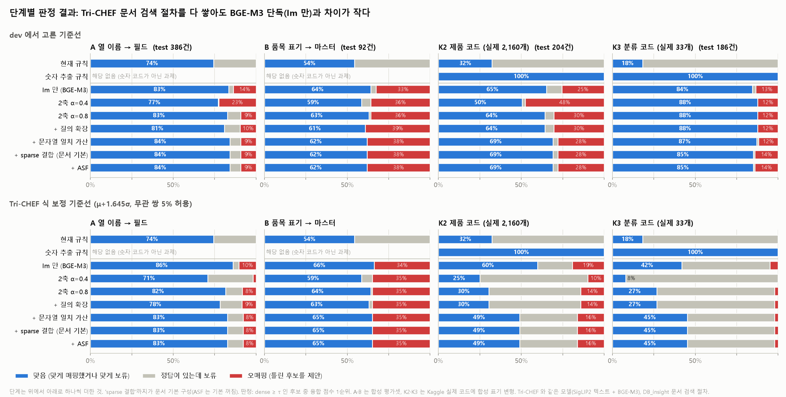
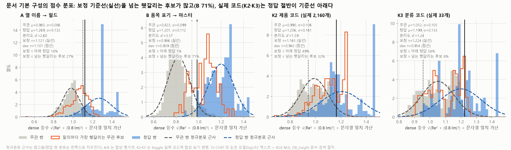
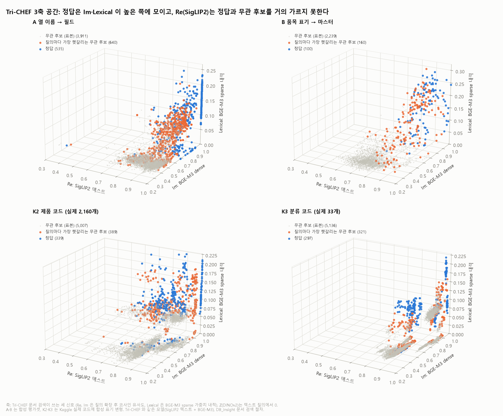
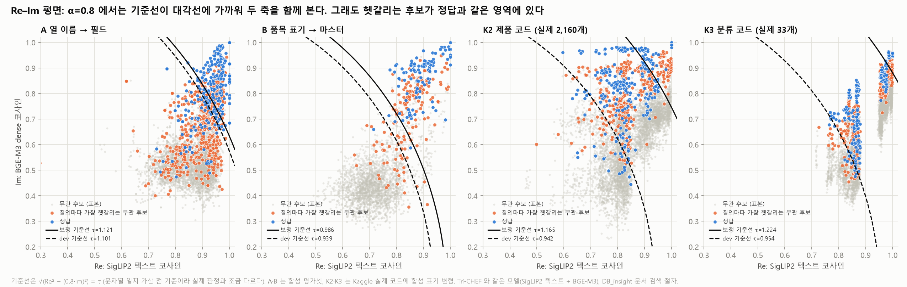
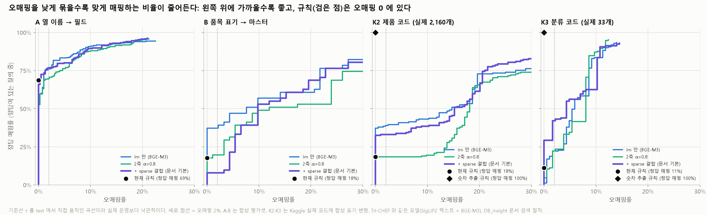
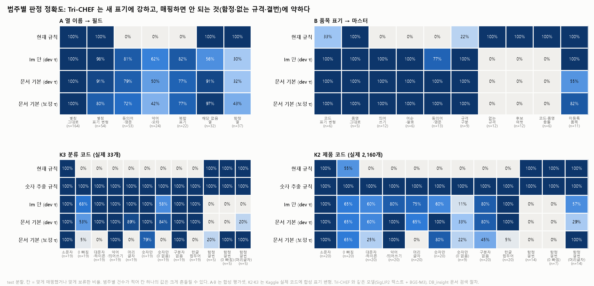
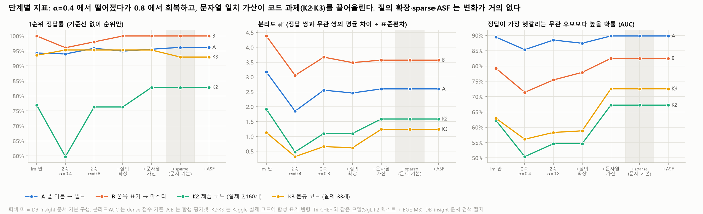

# retriever-eval

제조 데이터 매핑 과제에 Tri-CHEF 문서 검색 절차를 적용한 검색기 평가 실험이다.
업로드된 엑셀의 열 이름, 품목 표기, 코드 표기를 표준 필드와 기준 정보(마스터)에 연결하는 단계에서,
임베딩 기반 검색이 현재의 규칙 기반 매핑을 대체하거나 보완할 수 있는지를 측정한다.

## 요약

| 질문 | 결론 |
| --- | --- |
| 정답 후보를 상위에 올리는가 | 그렇다. 1순위 정답률 83~100% (현재 규칙의 정답 매핑률 11~69%) |
| 자동 매핑에 쓸 수 있는가 | 아니다. 오매핑률 9~38% (현재 규칙 0%) |
| Tri-CHEF 절차가 BGE-M3 단독보다 나은가 | 차이가 작다. 판정 정확도 차이 -2.2~+3.9%p |
| 권장 사용처 | 규칙이 보류한 건에 대해 후보를 순위대로 제시하는 용도 |

수치는 모두 test 분할 기준이다. 평가셋은 합성 데이터이며 한계는 [한계](#한계) 절에 정리했다.

## 실험 설계

### 평가 과제

| 과제 | 질의 | 후보 집합 | test 건수 |
| --- | --- | --- | --- |
| A. 열 이름 → 표준 필드 | 합성 열 이름 640건 | 백엔드 표준 필드 | 386 |
| B. 품목 표기 → 마스터 | 합성 품목 표기 160건 | 품목 마스터 69건 | 92 |
| K2. 제품 코드 | 실제 코드에 합성 표기 변형 9종과 결번 함정 | 제품 코드 2,160개 | 204 |
| K3. 분류 코드 | K2 와 동일 | 분류 코드 33개 | 186 |

K2·K3 의 코드는 Kaggle "Forecasts for Product Demand" 데이터셋(GPL-2.0)에서 가져왔다.
원본 파일은 이 저장소에 포함하지 않는다.

각 과제에는 매핑하면 안 되는 질의(해당 필드 없음, 존재하지 않는 규격, 결번 등)가 포함되어 있다.
이런 질의에는 보류가 정답이다.

### 검색 절차

Tri-CHEF 의 문서 도메인 검색 절차를 같은 모델로 단계별로 쌓아 가며 측정했다.

| 단계 | 내용 |
| --- | --- |
| Im 만 | BGE-M3 dense 코사인 유사도. 비교 기준 |
| 2축 α=0.4 | dense = √(Re² + (α·Im)²). Re 는 SigLIP2 텍스트, Im 은 BGE-M3. 식의 기본 α |
| 2축 α=0.8 | 문서 도메인의 기본 α |
| + 질의 확장 | 한·영 질의 변형들의 평균 임베딩 |
| + 문자열 일치 가산 | 질의 토큰이 후보 문자열에 포함되면 점수 가산 |
| + sparse 결합 | BGE-M3 sparse 내적을 min-max 가중 융합(0.60 / 0.25 / 0.15). 문서 도메인 기본 구성 |
| + ASF | 어휘 기반 필터. 기본 설정에서는 꺼져 있다 |

Tri-CHEF 의 세 번째 축 Z(DINOv2)는 이미지 전용이며 텍스트 질의에서는 0 이므로, 문서 검색은 Re·Im 2축으로 동작한다.

사용 모델: `google/siglip2-so400m-patch16-naflex` (Re), `BAAI/bge-m3` (Im, sparse).

### 판정과 지표

- 판정: dense 점수가 기준선 τ 이상인 후보 중 융합 점수 1순위를 제안하고, 해당 후보가 없으면 보류한다.
- 기준선 τ 는 두 방식으로 정했다. dev 분할(40%)에서 고른 값(dev τ)과,
  Tri-CHEF 의 보정식 μ_null + 1.645·σ_null (무관 쌍의 5% 허용, 보정 τ)이다.
- 결과 분류: 맞음(올바른 매핑 또는 올바른 보류), 보류 누락(정답이 있는데 보류), 오매핑(틀린 후보 제안).
- 분리도 d′: 정답 쌍과 무관 쌍 점수 평균의 차이를 표준편차로 나눈 값.
- AUC: 정답 후보의 점수가 해당 질의에서 가장 점수가 높은 무관 후보보다 높을 확률.

비교 대상 규칙은 두 가지다. "현재 규칙"은 백엔드의 정규화·별칭 일치 규칙이고,
"숫자 추출 규칙"은 코드 과제(K2·K3)에서 질의의 숫자 부분만 추출해 코드와 대조하는 규칙이다.

## 결과

### 판정 정확도와 오매핑률

각 칸은 판정 정확도 / 오매핑률이다 (test, dev τ).

| 방법 | A | B | K2 | K3 |
| --- | --- | --- | --- | --- |
| 현재 규칙 | 74.4% / 0% | 54.3% / 0% | 32.4% / 0% | 18.3% / 0% |
| 숫자 추출 규칙 | 해당 없음 | 해당 없음 | 100% / 0% | 100% / 0% |
| Im 만 | 83.4% / 13.7% | 64.1% / 32.6% | 65.2% / 25.5% | 84.4% / 13.4% |
| 2축 α=0.4 | 77.2% / 22.5% | 58.7% / 35.9% | 50.5% / 47.5% | 87.6% / 12.4% |
| 2축 α=0.8 | 82.6% / 9.3% | 63.0% / 35.9% | 64.2% / 30.4% | 87.6% / 12.4% |
| 문서 기본 구성 | 84.2% / 9.3% | 62.0% / 38.0% | 69.1% / 27.9% | 84.9% / 14.0% |
| 문서 기본 구성 (보정 τ) | 82.6% / 7.8% | 65.2% / 34.8% | 49.0% / 16.2% | 45.2% / 2.2% |

### 순위 품질과 분리도 (문서 기본 구성)

| 지표 | A | B | K2 | K3 |
| --- | --- | --- | --- | --- |
| 1순위 정답률 | 96.2% | 100% | 82.8% | 93.0% |
| 분리도 d′ | 2.60 | 3.57 | 1.59 | 1.24 |
| AUC (Im 만) | 0.894 | 0.792 | 0.622 | 0.629 |
| AUC (2축 α=0.4) | 0.853 | 0.714 | 0.504 | 0.561 |
| AUC (문서 기본 구성) | 0.898 | 0.825 | 0.672 | 0.725 |

### 오매핑률 2% 이하에서의 정답 매핑률

기준선을 test 분할에서 직접 조정한 값이므로 실제 운영 성능의 낙관적 상한이다.

| 방법 | A | B | K2 | K3 |
| --- | --- | --- | --- | --- |
| Im 만 | 77.0% | 37.3% | 39.1% | 22.2% |
| 문서 기본 구성 | 76.3% | 7.8% | 33.1% | 42.1% |
| 현재 규칙 (오매핑 0%) | 68.8% | 17.6% | 18.3% | 11.1% |
| 숫자 추출 규칙 (오매핑 0%) | 해당 없음 | 해당 없음 | 100% | 100% |

### 처리 시간

RTX 4060 Laptop 8GB 기준.

| 모델 | 질의 1건 | 묶음 처리 | VRAM |
| --- | --- | --- | --- |
| BGE-M3 | 31.7 ms | 1.33 ms/건 | 2,245 MB |
| SigLIP2 텍스트 | 40.1 ms | 2.93 ms/건 | 2,301 MB |

## 그림과 해설

### 그림 1. 단계별 판정 결과



각 막대는 test 질의 전체를 맞음(파랑), 보류 누락(회색), 오매핑(빨강)으로 나눈 비율이다.
위 행은 dev τ, 아래 행은 보정 τ 를 적용한 결과이며, 막대는 위에서 아래로 절차를 한 단계씩 더한 순서다.

- 규칙 기반 방법은 빨간 구간이 없다. 맞히지 못하는 질의는 모두 보류로 처리한다.
- 임베딩 기반 방법은 파란 구간이 늘어나는 대신 빨간 구간이 생긴다. B 과제에서는 33~39% 에 이른다.
- "Im 만"과 "문서 기본 구성"의 막대 구성이 거의 같다. 절차를 모두 쌓아도 BGE-M3 단독과의 차이가 작다.
- 보정 τ 는 실제 코드 과제(K2·K3)에서 지나치게 높게 잡혀, 오매핑은 줄지만 정답의 절반가량을 보류로 돌린다.

### 그림 2. 점수 분포와 기준선



문서 기본 구성의 dense 점수 분포다. 회색은 무관 쌍, 파랑은 정답 쌍, 주황 선은 질의별로 점수가 가장 높은 무관 후보다.
점선 곡선은 정규분포 근사이고, 세로 실선은 보정 τ, 세로 점선은 dev τ 다.

- 무관 쌍 전체(회색)와 정답 쌍(파랑)은 잘 분리된다. 분리도 d′ 는 이 두 분포를 비교한 값이다.
- 실제 판정을 어렵게 하는 것은 주황 분포다. 질의마다 가장 헷갈리는 후보는 정답 쌍과 같은 점수대에 놓인다.
  B 과제에서는 이 후보의 71% 가 보정 τ 를 넘는다.
- K2·K3 에서는 정답 쌍의 49%, 58% 가 보정 τ 아래에 있다. 무관 쌍 전체의 통계로 정한 기준선이
  짧은 코드 문자열에서는 정답까지 걸러낸다.
- 정답 쌍 분포는 한쪽으로 치우쳐 있어 정규분포 근사는 참고용으로만 본다.

### 그림 3. 3축 점수 공간



질의-후보 쌍을 Tri-CHEF 문서 검색이 사용하는 세 신호의 공간에 표시했다.
가로축은 Re(SigLIP2 텍스트 유사도), 깊이축은 Im(BGE-M3 dense 유사도), 세로축은 Lexical(BGE-M3 sparse 내적)이다.

- 정답(파랑)은 Im 과 Lexical 이 높은 영역에 모인다.
- Re 축 방향으로는 정답과 무관 후보가 겹친다. SigLIP2 텍스트 인코더는 짧은 문자열 사이의 차이를 거의 구분하지 못한다.
- 가장 헷갈리는 무관 후보(주황)는 세 축 모두에서 정답과 같은 영역을 차지한다. 축을 추가해도 이 후보들은 분리되지 않는다.
- K3 는 점들이 몇 개의 띠로 나뉜다. 후보가 33개뿐이고 표기 변형 유형별로 점수가 뭉치기 때문이다.

### 그림 4. Re–Im 평면과 기준선



그림 3 을 Re–Im 평면으로 투영하고 기준선 √(Re² + (0.8·Im)²) = τ 를 겹쳐 그렸다. 실선은 보정 τ, 점선은 dev τ 다.
곡선의 오른쪽 위가 매핑을 제안하는 영역이다.

- 정답과 무관 후보의 차이는 주로 세로 방향(Im)에서 나타난다.
- Re 값은 좁은 범위에 몰려 있어 판정에 기여하는 정보가 적다.
  α 가 작을수록 기준선이 Re 에 더 의존하게 되고, 이것이 α=0.4 에서 성능이 떨어지는 원인이다.
- 어떤 기준선을 택해도 제안 영역 안에 주황 점이 다수 남는다.
- 기준선은 문자열 일치 가산을 적용하기 전의 식으로 그렸으므로 실제 판정 경계와 조금 다르다.

### 그림 5. 오매핑률 대비 정답 매핑률



기준선 τ 를 움직였을 때 오매핑률(가로)과 정답 매핑률(세로)이 변하는 궤적이다. 왼쪽 위에 가까울수록 좋다.
검은 점은 규칙 기반 방법이고, 세로 점선은 오매핑률 2% 다.

- A 과제에서는 임베딩 기반 방법이 오매핑률 2% 에서 정답 매핑률 76~77% 로, 현재 규칙(69%)보다 높다.
- B 과제에서는 오매핑률을 2% 로 제한하면 문서 기본 구성의 정답 매핑률이 8% 로, 현재 규칙(18%)보다 낮다.
- K2·K3 에서는 숫자 추출 규칙이 왼쪽 위 꼭짓점(오매핑 0%, 정답 매핑 100%)에 있다.
  코드 값에는 단순한 규칙이 임베딩보다 낫다.
- 곡선은 test 분할에서 τ 를 직접 조정한 결과이므로 실제 운영 성능보다 낙관적이다.

### 그림 6. 범주별 판정 정확도



질의 범주별 판정 정확도다. 행은 방법, 열은 질의 범주이며 색이 짙을수록 정확도가 높다.

- 현재 규칙은 등록된 별칭과 매핑 금지 범주에서 100% 이고, 동의어·오타·복합 표기에서는 0% 다.
- 임베딩 기반 방법은 그 반대다. 규칙이 놓치는 새로운 표기는 대부분 맞히지만,
  매핑하면 안 되는 범주(함정 열, 없는 규격, 후보 여럿, 코드·품명 충돌, 결번)는 dev τ 기준 대부분 0~32% 에 그친다.
- 두 방법의 강점이 겹치지 않는다. 규칙이 먼저 판정하고 규칙이 보류한 건만 임베딩으로 넘기는 구성의 근거다.
- 범주별 건수가 5~20건인 칸이 많아, 칸 하나의 값은 변동이 크다.

### 그림 7. 단계별 지표



절차를 한 단계씩 더할 때 1순위 정답률, 분리도 d′, AUC 가 변하는 양상이다. 회색 띠는 문서 기본 구성이다.

- 분리도와 AUC 는 α=0.4 에서 떨어지고 α=0.8 에서 회복한다. K2 의 1순위 정답률은 77% → 60% → 76% 로 움직인다.
- 문자열 일치 가산은 코드 과제에서 효과가 뚜렷하다. K2 의 1순위 정답률이 76% 에서 83% 로 오른다.
- 질의 확장, sparse 결합, ASF 는 지표를 거의 바꾸지 않는다.
  질의 확장이 실제로 변형을 만든 질의는 A 65/640, B 107/160, K2 0, K3 33 건이었다.
- 분리도 d′ 는 A·B·K2 에서 BGE-M3 단독이 가장 높다.

## 결론

1. 임베딩 기반 검색은 후보 순위를 매기는 데 유효하다. 현재 규칙이 처리하지 못하는 동의어, 오타, 표기 변형에서
   정답을 1순위로 올린다.
2. 매핑 여부의 판정에는 쓸 수 없다. 표기가 비슷하지만 실제로는 다른 대상을 구분하지 못해 오매핑이 발생하며,
   기준선 조정만으로는 해결되지 않는다.
3. Tri-CHEF 의 추가 절차는 이 과제에서 BGE-M3 단독 대비 이득이 작다. SigLIP2 텍스트 축은 짧은 문자열에서
   분리 정보를 거의 제공하지 않는다.
4. 코드 값 매칭은 정규화 규칙을 보강하는 편이 효과적이다.
5. 따라서 규칙 기반 판정을 유지하고, 규칙이 보류한 건에 대해 BGE-M3 로 후보를 순위대로 제시해
   사람이 선택하도록 하는 구성을 권장한다.

## 한계

- 평가셋, 정답, 표기 변형은 모두 합성이며 백엔드의 별칭 목록을 참고해 작성했다. 실제 기업 데이터로는 측정하지 않았다.
- 표본이 작다. 범주별 건수가 5~20건인 경우가 많다. 95% 신뢰구간은 `results/trichef_results.json` 에 있다.
- 원래의 Tri-CHEF 는 문서 페이지 이미지와 캡션을 색인한다. 이 실험의 후보는 짧은 문자열이므로
  Re 축에 SigLIP2 의 텍스트 인코더를 사용했고, 캡션과 paraphrase 는 사용하지 않았다.
- 숫자 추출 규칙의 100% 는 질의가 모두 숫자 덩어리 하나를 포함하는 형태였기 때문이며 일반 성능이 아니다.
- 리랭커와 CPU 전용 환경에서의 전체 절차는 측정하지 않았다.

## 저장소 구성

| 경로 | 내용 |
| --- | --- |
| `data/` | 합성 평가셋 (열 이름 질의, 품목 질의, 품목 마스터, 필드 정의) |
| `scripts/build_dataset.py` | 평가셋 생성 |
| `scripts/trichef_experiment.py` | 실험 본체 |
| `scripts/trichef_figures.py` | 그림 생성 |
| `results/` | 실험 결과 JSON |
| `figures/` | 그림 7장 |

## 재현

요구 환경: Python 3.11, CUDA 지원 PyTorch, `transformers`, `matplotlib`, `scipy`.
Tri-CHEF 구현(DB_insight)과 Kaggle 원본 CSV 가 로컬에 있어야 한다. 두 가지 모두 이 저장소에 포함되어 있지 않으며,
DB_insight 경로는 `scripts/trichef_experiment.py` 의 `DBI` 상수에서 지정한다.

```powershell
python scripts\trichef_experiment.py "<Historical Product Demand.csv 경로>"
python scripts\trichef_figures.py
```

`build_dataset.py` 는 백엔드 저장소의 매핑 규칙을 import 하므로 백엔드의 가상환경에서 실행한다.
